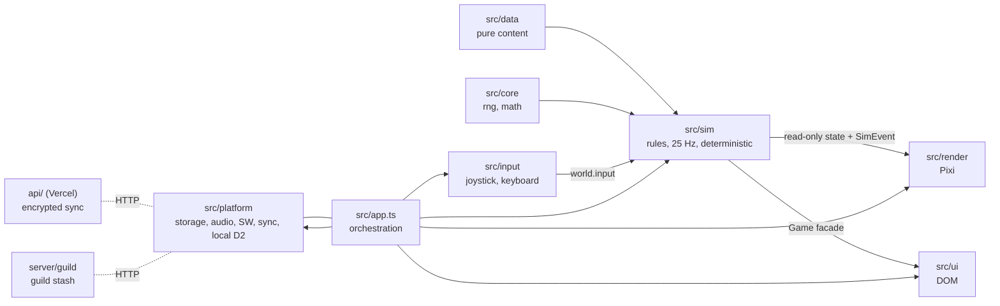
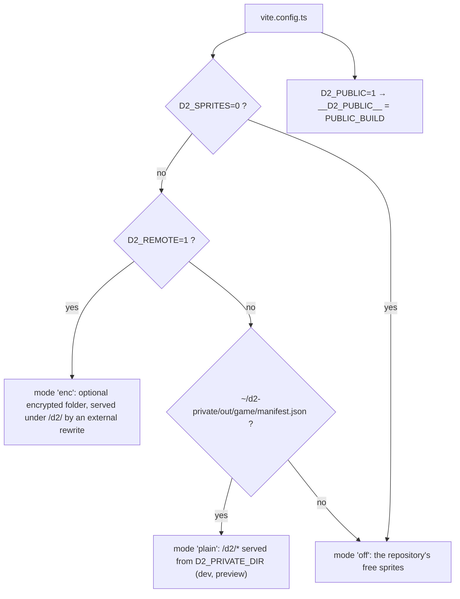

# Architecture — D2 Mobile

An overview of the code, followed by details by topic. Each main folder has its own README
(`src/sim`, `src/data`, `src/render`, `src/ui`, `src/platform`, `api`, `server/guild`, `server/stats`); the step-by-step guide to adding
content is in [GUIDE-CONTENU.md](GUIDE-CONTENU.md), and the vocabulary is in [GLOSSAIRE.md](GLOSSAIRE.md).

## Contents

1. [Layers](#layers) · 2. [Startup](#startup) · 3. [One frame](#one-frame) · 4. [Saving](#saving)
5. [Public build and full build](#public-build-and-full-build) · 6. [Service worker and updates](#service-worker-and-updates)
7. [Graphics generated on the device](#graphics-generated-on-the-device-local-d2) · 8. [Guild](#guild-online-shared-stash) · [Anonymous statistics](#anonymous-statistics-player-counter)
9. [Extension points and enforced rules](#extension-points-and-enforced-rules) · followed by the older detailed sections (rendering, projection,
pre-rendering, texture budget, loop, bots, .d2s import, synchronization, [zones joined edge to edge](#zones-joined-edge-to-edge-seams-lots-311-312-314)).

## Layers



Layer details: they only talk to each other in one direction.

```
  data (src/data)  ──►  simulation (src/sim)  ──►  events + read-only state
                                   ▲                         │
          player input (src/input) / bots (src/sim/bot)      ▼
                                                  rendering (src/render)   UI (src/ui)
```

| Layer | Role | Never does |
|---|---|---|
| `src/data` | All the content: bases, affixes, uniques, sets, runes, runewords, monsters, skills, curves, rates (`rates.ts`), maps (`zones/`), runs. | No runtime logic, no imports from `render`/`ui`; from `sim`, only types, except `zones/d2passable.ts` (reuses the collision grid to check the D2 maps). |
| `src/sim` | Game rules on a fixed 25 Hz step, in **world coordinates** (1 unit ≈ 1 m, x/y plane, z height). Deterministic (seeded generators, separate streams). Single facade: `Game`. | No imports of `pixi.js`, the DOM, `render`, or `ui`. No rule derived from an image. |
| `src/render` | Reads the world state and the events, and draws. Projection, sprites, lighting, effects, labels. | No writes to the simulation state. No rules. |
| `src/ui` | DOM layer on top of the canvas: HUD, panels, menus, tooltips. Calls the `Game` facade. | Does not touch the rendering or the world's internal structures. |
| `src/input` | Joystick, buttons, aiming (auto/manual), keyboard/mouse. Writes only `world.input`. | No game rules (auto-aim is a read-only query, `sim/targeting.ts`). |
| `src/platform` | Local and file saves, audio, vibration, service worker, mobile lifecycle. | — |
| `src/debug` | `window.__arpg` hook (level, items, runs, advancing the simulation, forced drops/corruptions, god mode). | Not used by the game itself. |

The rule is enforced by import type checking (no file in `sim` imports `render`,
`ui`, `pixi.js`, or `document`) and by the fact that all three bots run in Node without a DOM.

## Startup

`index.html` (containers `#stage`, `#hud`, `#panels`) → `src/main.ts` (styles, `pixi.js/unsafe-eval` to do without `eval` under the CSP,
global error handlers, language, DOM translation) → `new App(root).start()` (`src/app.ts`).

- **Two-stage loading.** `app.ts` imports only *types* from the game core; the core (`Game`, `GameRenderer`, `Hud`, `Panels`,
  `Controls`, audio, debug hook, bots…) is a single module, `src/game-core.ts`, loaded on demand by `loadCore()` and used through
  the `G.` namespace. It downloads while the player is looking at the selection screen. Whatever is needed before that (selection,
  synchronization, saving, sprites, i18n, local D2) is imported statically.
- **`App.start()`**, in order: service worker (`registerServiceWorker`), sprite bank + i18n, local D2 mode gates, menu
  music, synchronization (5 s at most; the game starts offline), `chooseCharacter()` (selection screen; benchmark, automated browser
  or `?class=`: no screen), audio, `GameRenderer` (WebGL or WebGPU), D2 maps if any, `Hud`, `Tips`, `Panels` (receives a
  `PanelHost`: callbacks into the application), `Controls`, settings, lifecycle, **debug hook** `window.__arpg`
  (`G.installDebugHook`), update monitoring, entering the last town, first `requestAnimationFrame`.
- `useSlot()` creates `new G.Game(save, classe, true)`, applies the application's default settings, attaches the **shared stash**
  (`SaveStore.loadShared()` → `game.attachShared`) and marks the slot as active.

## One frame

```mermaid
sequenceDiagram
  participant RAF as requestAnimationFrame
  participant App as App.frame
  participant In as Controls / BotBrain
  participant G as Game.step(1)
  participant R as Renderer, Audio, Hud, Tips
  RAF->>App: now
  App->>App: dt capped at 0.25 s; paused while a panel is open, the tab is hidden or an area is loading
  loop while acc ≥ DT (1/25 s)
    App->>In: controls.apply() (writes world.input) or botStep()
    App->>G: step(1) (exception logged, not dropped)
    G-->>App: SimEvent[] (queue emptied at every step)
  end
  App->>App: world changed → syncZone() (loading, save)
  App->>R: ≤ 60 fps: handleUiEvents, render(world, alpha = acc/DT, events), audio, haptics, HUD, tips, minimap
  App->>App: adaptive quality, frame guard, save every 30 s
```

- `TICK_HZ = 25`, `DT = 1 / TICK_HZ` (`src/sim/constants.ts`). The simulation never reads the clock: `Game.step` advances by one tick
  (`world.step`, game time, events handled by `Game.handle`, auto-walk, return to town after death).
- Panel open: no simulation steps (single-player game paused), rendering with `alpha = 1`. `?freeze` sets `timeScale` to 0; the debug hook
  can speed it up (0 to 16).

## Saving

- **Format**: `SaveData` (`src/sim/save.ts`: character, settings, current run with its monsters and ground items, counters, town),
  `SAVE_VERSION` and `MIGRATIONS` applied by `migrate()` (rejects a future version). Shared stash kept separately: `SharedStash`,
  merged by `uid` (`mergeShared`).
- **Storage**: `SaveStore` (`src/platform/platform.ts`), `localStorage`: `d2m.save.<uuid>` (+ `.backup`, kept only if the
  previous copy was valid, and `.presync` before a replacement by sync), `d2m.active`, `d2m.shared` (+ `.at`): shared stash of the `pd2` ruleset; any other ruleset has its own, `d2m.shared.<id>` (+ `.at`), and the stash merged into the game is the one for the character's ruleset (`SaveStore.loadShared(ruleset)`, batch 216).
  The other `d2m.*` keys are local preferences (language, settings category, local D2 state, error log…) that are never
  synchronized.
- **When** (`App.saveNow`, shared stash written first): every 30 s, on every zone change (`syncZone`), at the end of a run,
  when the tab is hidden (`visibilitychange`), on `pagehide`, on WebGL context loss, after a bulk stash operation, and before a reload
  (character change, import, update). The benchmark never saves.
- **Export / import**: JSON file (`SaveStore.exportFile` / `importFile`); import goes through `parseImportedSave`
  (`src/sim/save-check.ts`: size ≤ 10 MB, JSON, migration, structural validation) and always becomes a new slot.

## Public build and full build



- Injected constants: `__D2_SPRITES__` (`'enc' | 'plain' | 'off'`, read by `src/render/assets.ts`; at runtime the mode can also
  become `'local'`, graphics generated on the device) and `__D2_PUBLIC__` (`src/platform/build-flags.ts` → `PUBLIC_BUILD`).
- **`PUBLIC_BUILD`** removes: synchronization (`Sync.init` does nothing, option and buttons hidden), the stash's Guild tab, the
  test character and `?testmerc`, and it forces the "your own Diablo II files" choice screen on first launch, which cannot be skipped:
  the game is not played without the Diablo II graphics (the player's files). Only a test build (`D2_ALLOW_SKIP=1`,
  `__D2_ALLOW_SKIP__`, e2e scripts without MPQs; never deployed) shows the "replacement graphics" link.
- Publishable build: `D2_SPRITES=0 D2_PUBLIC=1 npx vite build`, checked by `tools/e2e/public-build.mjs` and `public-no-testchar.mjs`.

## Service worker and updates

- Generated **at build time** by the `d2m-sw` plugin in `vite.config.ts`: it walks `dist/`, computes the version (fingerprint of the file names and
  sizes + template) and fills in `src/platform/sw-template.js` → `dist/sw.js`. The core (everything except `sprites/*`, `d2/*`) is pre-cached at
  install time; sprite sheets are preloaded on demand (`PRECACHE`, 8 s after startup). `/api/` is never intercepted.
- **Policy** (`registerServiceWorker`, `appUpdate` in `platform.ts`): checks every 10 min and when the app returns to the foreground;
  the application passes `canUpdateNow = () => false`, so a new version is **never** applied in the middle of a game: it is applied on the next
  launch, or through "Install now" (the `App.watchUpdates` dialog, Settings › Application), with a save before reloading.

## Graphics generated on the device (local D2)

For a player who owns the game: `src/platform/d2local.ts` (engine), `d2local-core.ts` / `d2local-prep.ts` (pure logic: queue,
priorities, preparation order), `d2local.worker.ts` (exporters shared with `tools/d2import`).

1. The player picks their `.mpq` files (`src/ui/d2-choice.ts`, `d2local-ui.ts`); they are copied into the OPFS (or their handles are kept).
2. Archive integrity check (quick or full, MD5 for information only).
3. **Lazy** generation by priority (interface, icons, zone map, ground, player, monsters, items, effects, sounds) in
   workers; results go into the `d2m-d2-local` cache, invalidated by `GENERATOR_VERSION` and by the archives' fingerprint.
4. `SpriteBank` hot-swaps the sprites; application gates: `localBootGate` (interface before the first screen),
   `localTownGate` (town map), `installRunGate` (a run waits for its maps); background preparation of the next zones
   (`d2pregen.ts`, suspended if smoothness drops, the tab is hidden or the battery is low).

Nothing is sent to a server; `d2cache.ts` concerns the cache of encrypted packs (`D2_REMOTE`), not this generation.

## Guild (online shared stash)

Client `src/platform/guild.ts` (`Guild`, relative base `/guild-api`, session per device and per ruleset, `d2m.guild` for `pd2`, `d2m.guild.<id>` otherwise; the ruleset is sent with every request and checked by the server (a stash from another ruleset is rejected, batch 217); idempotency key `reqId`:
a deposit only removes the item locally after the server's response), interface `src/ui/guild-ui.ts` (stash tab, refreshed every
20 s). Dependency-free server `server/guild/index.mjs` (JSON on disk, listens locally by default, caps): see
[server/guild/README.md](../server/guild/README.md). `/guild-api` proxy: `vite.config.ts` in dev, a rewrite in `vercel.example.json`.

## Anonymous statistics (player counter)

Client `src/platform/stats.ts` (`StatsClient`, relative base `/stats-api`): random identifier (`crypto.randomUUID`, `localStorage` `d2m.stats.id`), a ping on opening and then every 60 s, only while the tab is visible,
`playing` flag (character in game: `App.start`), version (date of the latest entry in `changelog.ts`), site (`PUBLIC_BUILD` ? `public` : `owner`, the protocol value of the full build). Per-device setting "Anonymous usage statistics" (Settings › Advanced, on by default;
turned off = nothing sent and the identifier deleted); "Do Not Track" and Global Privacy Control are respected; failures are silent (404: the client stops trying). Nothing in development (except `?stats-test`), in benchmark mode, or in an automated browser.
Dependency-free server `server/stats/index.mjs` (`node:sqlite`, no IP or User-Agent stored, raw pings purged after 48 h, aggregates per identifier and per day, `/stats` protected by `STATS_ADMIN_TOKEN`): see
[server/stats/README.md](../server/stats/README.md). `/stats-api` proxy: `vite.config.ts` in dev, a rewrite in `vercel.example.json` to `STATS_API_URL` (`tools/deploy.mjs` → `tools/deploy-config.mjs`: `--code` and `--public`, the only rewrite kept in the public build).
The public build embeds no server address (test `tests/unit/stats-deploy.test.ts`). Exactly what is collected: [PRIVACY.md](../PRIVACY.md).

## Extension points and enforced rules

- `tests/unit/architecture.test.ts`: no file in `src/sim` or `src/data` imports `pixi.js`, `render/`, `ui/`, `input/`,
  `platform/`, or uses `document`, `window`, `localStorage`, `requestAnimationFrame`, `Math.random()`; `Date.now()` /
  `performance.now()` only in `src/sim/bot`; `src/render` does not write the world state (heuristic).
- `src/sim/hooks.ts`: two late-bound extension points (`simHooks.castSkill`, registered by `skill-cast.ts`;
  `simHooks.spawnMonster`, by `spawn.ts`) that avoid value-import cycles (there are none).
- Shared types live in leaf modules (`sim/character-state.ts`, `sim/map-boss-state.ts`, `sim/actors.ts`, `data/skill-types.ts`,
  `data/zone-types.ts`): a module that only needs a type does not depend on the logic that manipulates it. The only remaining cycles
  go through **type** imports towards the four facades (`World`, `Game`, `Panels`, `GameRenderer`) that their linked modules
  receive; they are erased at build time.
- In CI (`.github/workflows/ci.yml`): `tsc`, ESLint (`src`, `api`, `server`, `tests`, `tools`), Prettier, unit tests, `npm audit`,
  gitleaks, coverage with thresholds (`vitest.config.ts`).

---

## Rendering boundary and migration to Three.js

The renderer consumes only:

1. **`ZoneDef`** (pure data): size, ground by area, walls (axis-aligned segments), props
   (identifier + position + variant + scale), lights (position, radius, color,
   height), interactive objects, exits. No screen coordinates.
2. **The read-only world state**: `world.player`, `world.monsters`, `world.missiles`,
   `world.areas`, `world.items`, `world.objects` — world positions, orientation (`facing`,
   radians), animation mode (`idle`/`walk`/`attack`/`cast`/`hit`/`death`) and time within the
   mode (`modeT`/`modeLen`), display tint/scale.
3. **The events** (`SimEvent`): impacts, novas, beams, damage, deaths, drops, portals…

A 3D engine (Three.js) would replace `src/render` without touching the other folders:
- each `PropPlacement` → an instance of the source glTF from `assets-src/` (same prop identifier;
  the `src/data/props.ts` table already references the source model, its footprint and its rotation);
- each actor → a `SkinnedMesh` of the same model, with the clip chosen by the mode (the clip names
  are in `tools/prerender/catalog.ts`), orientation = `facing`;
- `LightDef` lights → `PointLight`, `GroundPatch` ground → materials;
- the events drive the effects exactly as they do today.

The 3D sources stay in the repository (`assets-src/`, excluded from the build) and the pre-rendering pipeline
loads them with the same `GLTFLoader` as Three.js: a 3D renderer would see the same models, the
same tints and the same color grading (the `gradeMaterial`/`prepareMaterial` functions are reusable).

## Projection (current 2D rendering)

Orthographic, 45° yaw, 30° elevation: a 2:1 diamond. At scale 1:
`écranX = (x − y) × 32`, `écranY = (x + y) × 16 − z × 39,2` (px), i.e. K = 45.25 px per unit
in the camera plane. Direction `i` of a sprite sheet ↔ world angle `i × 2π / N` from +x.
Depth sorting by the `x + y` of the feet. Main light from +x, 60° elevation: shadows
toward the top-left of the screen, rendered separately (half resolution, alpha 0.55).

## Pre-rendering pipeline (`npm run sprites`)

Headless Chromium + Three.js: glTF loading, per-mesh hiding/tinting, scaled
bones, accessories, scaling by height or by collision footprint, **measurement of the
bounding box** (all animations and directions, shadow included → a cell with no clipping), ×4 rendering,
color grading (S-curve, saturation, partial toning), downscaling in linear light, binary
alpha, OKLab quantization onto the art direction's palette (Bayer dithering for the ground),
cropping, atlas ≤ 2048, PNG-8. Two tiers: `hi` (scale 1) and `lo` (½). Separate shadows.
Cache keyed by fingerprint (specification + model files + engine): one command, reproducible,
rebuilds only what has changed.

## Texture memory budget

Measured at runtime (`SpriteBank.gpuBytes()`, shown in the performance overlay) and at
build time (`public/sprites/manifest.json`, GPU bytes per tier).

| Tier | Budget per zone | Target devices |
|---|---|---|
| `hi` (high/medium quality) | **≤ 128 MB** | recent mid-range and high-end |
| `lo` (low quality) | **≤ 40 MB** | 3-4-year-old mid-range, automatic fallback |

Levers, in order: zone-by-zone loading (only the sheets of the current zone and of the
town are in memory), texture scale per sheet (large monsters ×0.75, bosses ×0.6),
number of frames per animation, `lo` tier. Adaptive quality (hysteresis, no
oscillation) changes the rendering resolution, lighting and particles — never the
simulation.

## Loop, time and lifecycle

- Fixed-step simulation (25 Hz), independent of the display refresh rate; rendering capped
  (≈ 60 fps) with position interpolation.
- Tab hidden → pause and full save (even in the middle of a run: monsters, ground
  items, generators); resumes after the app is closed. WebGL context loss → textures
  reloaded on restore.
- Service worker: core pre-cached, sprite sheets preloaded in the background; a new
  version is only applied at the next launch or at the player's request (see above).

## Bots and tools

- `src/sim/bot/brain.ts`: shared brain (town: points, equipment found, selling, potions,
  run choice; run: potions, backing off, spell choice, loot, A* exploration).
- `src/sim/bot/runner.ts`: full run and progression session (per-stage measurements).
- `src/sim/bot/arena.ts`: the combat bot's arena (TTK, lethality).
- `tests/bots/*.test.ts` (`npx vitest run --project bots`) and `tools/bots/progression.ts`
  (command line, JSON report in `test-results/bots/`).

## Diablo II character import (.d2s)

- `src/sim/d2s/parse.ts`: pure reader for the .d2s format 1.10 to 1.14d (version 96 / 0x60): header, quests (Baal per difficulty), attributes (`gf`), skills (`if`), `JM` item lists (character, corpse, `jf` mercenary, `kf` golem), items read bit by bit (flags, code, quality, unique/set/rare/magic, runewords, defense, durability, quantity, sockets and socketed items, magic properties according to ItemStatCost). Version 0x61 (D2R 1.x: Huffman-coded item code, no per-item `JM`) is implemented but UNTESTED; recent D2R versions (≥ 0x62) are rejected. An error in the items does not abort the file: items read before the error are kept (`truncated`).
- `src/data/d2s-tables.gen.json` (generated by `tools/d2s/gen-tables.ts` from the MPQs, committed): ItemStatCost (bits/add/parameter), item codes → game bases, uniques/sets/runewords → game ids (`u_*`, `s_*`, `rw_*`), magic affix names, D2 skills → game ids. D2 identifiers: the "Expansion" rows do not count; runewords = 26 + the row index of the `RunewordN` row (Delirium = 2718). Cross-checked against an independent implementation of the format (the `@dschu012/d2s` reader/writer): same unique names, same runeword names, same properties.
- `src/sim/d2s/convert.ts` + `props.ts`: conversion to `SaveData` and an import report (`ImportReport`, `reportLines`). Magic/rare/crafted: properties converted to `craftMods` (the game does not have vanilla D2's affixes); uniques/sets/runewords: the game's definitions (PD2), with rolled values taken from the file when the stat exists. Offline item listing: `tools/e2e/d2import.mjs`.
- `src/platform/d2files.ts` + `src/ui/d2import.ts`: files picked by hand (`.d2s` input, multiple) or a remembered save folder (File System Access API, handle in IndexedDB, read on demand with permission). The reader and tables are only loaded when the import dialog is opened.
- Partial: mercenary (D2 types → game types, head/body/weapon equipment), belt (best tiers, up to its capacity), Cube → stash (tab 2), weapon swap → inventory, corpse and golem items ignored, charges and a few rare properties lost (flagged "approximate"). PD2 saves (added properties) are not supported.

## Synchronization (account, encrypted saves)

Goal: get your characters back when switching devices (phone ↔ PC) without export/import. An account chosen by the player (name + password, no e-mail), automatic synchronization, **zero knowledge**: the server never sees the password or a save in plaintext.

**Files.** Client: `src/platform/sync-crypto.ts` (Web Crypto), `sync-merge.ts` (pure merge), `sync.ts` (engine: session, deferred upload, conflicts), `src/ui/sync-ui.ts` (Settings › Synchronization, dialog on the selection screen, conflict dialog). Server: `api/sync.ts` (Vercel Node function, `POST /api/sync`), `api/_lib/core.ts` (logic, tested with a fake storage), `api/_lib/blob-store.ts` (Vercel Blob, **private** store `d2m-sync`). The service worker never touches `/api/`.

**Cryptography.** `PBKDF2-SHA256(mot de passe, sel = sel public du compte ‖ nom, 600 000 itérations)` → 64 bytes: the first 32 = AES-256-GCM key for the saves (never sent; imported `extractable:false`), the last 32 = `authHash` sent to the server. Blob: `[version=1][IV aléatoire 12 o][AES-GCM(données) + étiquette]`, data = `[0 brut | 1 gzip] ‖ texte de la sauvegarde`; the slot identifier is additional authenticated data (the server cannot swap two saves). Password: 10 characters minimum, never stored; the derived key stays in memory, and is kept on the device (IndexedDB: non-extractable `CryptoKey` + `authHash`) only if "Stay signed in" is checked.

**Server storage (Blob).** `accounts/<HMAC(pepper, nom)>.json` = public salt, iterations, server salt + `SHA-256(sel serveur ‖ authHash)` (constant-time comparison), failure counter/lock, **slot index** (`updatedAt` = increasing server version, `savedAt`, size, format version). `saves/<h>/<slot>.<updatedAt>.bin` = encrypted blob (one name per revision: the old one is deleted after the index is committed). `staging/…`: re-encrypted blobs during a password change. The account name never appears in plaintext in the paths (HMAC with the server secret `SYNC_PEPPER`).

**API** (JSON, always `Cache-Control: no-store`): `params` (salt + iterations; a deterministic fake salt if the account does not exist), `register`, `login`, `list`, `get`, `put` (`baseUpdatedAt`: **409 `conflict`** if the server version is newer), `delete` (one slot with a version check, or `all` = the whole account), `stage` + `changePassword` (the client decrypts with the old key, re-encrypts with the new one, stages, then commits). Conditional index write (`ifMatch` on the account's ETag): two devices writing at the same time do not overwrite each other; the loser gets a 409. Limits: 2 MB per save, 30 slots, 3.8 MB body (Vercel limit 4.5 MB), names `[a-z0-9_.-]{3,32}`.

**Merge (per slot).** Each device remembers, per slot, the "stamp" of the last sync `{version serveur, date locale}` (`d2m.sync.meta`). Missing locally → downloaded; server changed and local unchanged → replaced (the old local version is kept in `<clé>.presync`); local changed and server unchanged → uploaded; **both changed → conflict**: a dialog showing the level, XP and date of both versions, with the choice "keep this device / the other one / both (the other one becomes a new character) / later". Never a silent overwrite; lost stamp + different contents = conflict. The character currently being played is never replaced during play. A local deletion deletes the online copy only if nobody has modified it since; otherwise the character comes back. The shared stash is the `shared` slot (its own date, `d2m.shared.at`) for `pd2`, `shared-<id>` for any other ruleset; a version's summary (conflict dialog) includes the ruleset of the character or of the stash. Local settings (quality, controls, loot rate) are not synchronized. Slot identifiers are UUIDs (`SaveStore.newSlot`); the original `d2m.save` slot is migrated to a UUID on the first sync.

**Triggers.** At launch and when the selection screen opens (5 s at most; offline, the game starts anyway), on every save (`SaveStore.onSaved`, deferred upload after 10 s), when going to the background (`visibilitychange`), on close (`pagehide`, `fetch keepalive` only for small blobs: the browser limit is 64 KB, beyond that it is best-effort), when the network comes back (`online`) and on demand.

**What the server sees / does not see.** It sees: the `authHash` (never the password), the account name during the request (not stored in plaintext), the request's IP address, the number and size of the slots, the save dates and the slot identifiers (UUIDs), the blob's format version. It does not see: the password, the encryption key, the content of the characters (name, level, items…). A malicious server could delete a save or send back an old version of it (but not modify or swap it: AES-GCM + authenticated slot); an old version sent back would look like "server is newer" and would replace the local copy (the old local copy is then kept in `.presync`).

**Accepted limitations.** (1) No password recovery (by design: the server cannot decrypt). (2) Blob has no atomic counter: per-IP rate limiting **in the instance's memory** (best-effort; several instances = several counters); the real protection against guessing is the soft lock stored in the account (5 failures → 30 s lock, doubling up to 15 min, with an increasing response delay; a device that has already signed in sends a random token (`d2m.sync.device`, fingerprint kept in the account, 10 devices at most) and is not subject to this lock, its own failures being counted separately: a third party who knows the name can therefore only block a new device) and the client-side PBKDF2 cost. If the storage leaks, guessing a password costs 600,000 iterations per attempt. (3) Account creation: 5 per hour per IP; global cap of 200 accounts (`SYNC_MAX_ACCOUNTS`, counter `meta/accounts.json` with conditional writes, rebuilt by counting `accounts/` if it is missing) and 16 MB of saves per account (`SYNC_MAX_ACCOUNT_BYTES`, `413 quota` rejection only if the size increases); a single staged copy per slot during a password change, the size of the save; no expiry for unused accounts. (4) An unknown account at `login` returns the same 401 error as a wrong password, but `register` reveals that a name is taken. (5) The password change commits the re-encrypted blobs and then the index in two steps: if it is interrupted between the two, retry with the old password (the local copies remain the reference). (6) CORS: only requests from the same host, from the origins listed in `SYNC_ALLOWED_ORIGINS`, and from localhost outside production are accepted.

**Deployment.** Environment variables of the Vercel project: `BLOB_READ_WRITE_TOKEN` (set when the project's Blob store is created) and `SYNC_PEPPER` (≥ 32 characters, **never change it**: it is used to find the accounts); neither is in the repository or in the bundle. `npm run deploy` (prebuilt `vercel build`) ships `api/` together with the site. Tests: `tests/unit/sync-*.test.ts` (encryption, merge, API with a fake Blob, two-device engine), `tools/e2e/sync.mjs` (two Playwright contexts, mobile + PC, conflict).

## Zones joined edge to edge (seams, lots 311-312, 314), zones kept for the session (lot 316)

Diablo II lays the Rogue Encampment, the Blood Moor and the plains after it side by side: the camp's palisade has a gate on the
level's edge and the next level's ground goes on beyond it, with no loading. Our zones are one D2 map each (the town's DS1, the
outdoor zones assembled from Act I's pieces by `tools/d2import/act1-maps.ts`), so the camp used to stand in black, and its exit was
the point farthest on foot from the waypoint (a corner by the river): a player walking out of the gate met the map's edge.

- **Data** (`src/data/zones/seams.ts`): `openings(map)` finds the walkable runs that reach a map's border (the first free row inside
  the importer's two border rows, no wall tile on the edge's case: the camp's gate, the gaps of the `bord*` pieces); `planChain`
  joins each pair of Act I's outdoor chain (`A1_CHAIN` in `act1.ts`: town, Blood Moor, Cold Plains, Stony Field, Dark Wood, Black
  Marsh, Tamoe Highland) at facing openings (the exit farthest on foot from the entry), the openings' middles aligned and the maps
  overlapping by `OVERLAP` (5 units: each map's two border rows are walls, the overlap is where both are walkable). `seamOf` gives,
  for each side, `at` (the neighbour's origin in this zone's coordinates), the crossing rectangle (closer than `CROSS_DEPTH` to the
  edge, the other side's crossing 1 unit beyond: no ping-pong) and the part of the neighbour drawn (`SEAM_VIEW` around the opening).
- **Zones** (`act1.ts`): `ZoneDef.seams`; the exit object stands in the opening; a zone entered from its predecessor starts in that
  opening (`withD2Farm(…, entry)`: its monsters kept away from it); the overlap's collision is made one (`mergeOverlap`: a sub-tile
  facing the neighbour's palisade or trees is blocked). Pairs without facing openings (the monastery) keep their portals.
- **Simulation** (`Game.autoWalk` → `crossSeam`): the hero inside a crossing rectangle enters the neighbour (lot 311: built then by
  `enterCampaignZone`, the same seed as ever; lot 312: the world built ahead and simulated beside the zone, below) at the same place in
  its coordinates (`p − at`), facing and walking as he was; the companions follow, no town portal is opened. Rule `world.seams` (base true; Survivals false: its hub and arenas keep their flow, its town exit stays the
  walked-over portal, now at the gate).
- **Rendering** (`GameRenderer.showNeighbours`, `D2MapView` with an offset): the neighbour's part near the edge is drawn beyond it
  (its ground under the zone's, its structures depth-sorted with the actors), loaded in the background after the zone. At a crossing
  (lot 311: `seamSwap`, set by the application, a `setZone` keeping the maps; lot 312: `swapAtSeam`, the whole scene kept, below; the
  lot-311 path stays the fallback when the neighbour's map is not on screen) the views on screen are kept: the neighbour becomes the zone (moved to offset 0, the rest of
  its map loaded behind the play, `extend`), the zone becomes the neighbour (moved, cut to its part, `trim`). The application keeps
  the joystick, the keys and the held mouse (`Controls.onSeam`), shows no loading screen before 1.5 s (`SEAM_LOADING_DELAY_MS`), and
  prepares the neighbours' monster sheets during the zone (`Game.neighbourZones`). Measured (SwiftShader, dev server): the image held
  55-150 ms at a crossing (`App.seamMs`), the scene unchanged on screen.
- **Lot 312: one world** (owner: "as if it were a single zone as in the real game"; `src/sim/seam-worlds.ts`, `Game.seams`). Each zone
  stays its own `World` (its grid, monsters, level, difficulty scaling, magic find, quests, waypoint, minimap, save); what changes is
  that the neighbours of the zone the hero is in live beside it:
  - *built ahead*: within `SEAM_IDLE` (90 units) of a seam the application builds the neighbour in idle time, a few milliseconds per
    idle period (`SeamWorlds.prepareStep`: the zone's build is a generator, `src/data/zones/steps.ts`, `RunDef.buildSteps`; the same
    zone as `build`, the `zones` fingerprint is unchanged by the steps); the simulation builds it at once at `SEAM_PREPARE` (60) if it
    is not ready (tests, bots, a teleport). Its identifiers start at its own `WorldOptions.idBase` (2^24 apart), so that an entity keeps
    its identifier on both sides;
  - *simulated in lockstep* within `SEAM_ACTIVE` (40, released at 48): its tick follows the zone's, its player is a **proxy** of the hero
    (his place in its coordinates, his stats and buffs shared; `World.proxy`: no inputs, no regeneration), so its monsters see him, wake,
    chase and strike; they stay on their own map (as in Diablo II), coming to its edge (its flow field aims at the nearest point of its
    map). Their blows go to the hero in his zone (`World.seam.hurtPlayer`, the attacker's copy as the source: hit chance, mods, thorns);
    the life and mana its step gives the proxy (leech, life after a kill) go to the hero. Beyond its edge a zone sees and shoots into
    the neighbours' maps (`WalkGrid.outside`: their walls stop sight and missiles), so sight and missiles cross the seam;
  - *mirrored*: its monsters, ground items, objects, missiles and areas within its drawn part (`SeamDef.view` + 6) are copied each step
    into the zone (`mirror: true`, same identifiers, its coordinates + `at`): the renderer, the minimap, the targeting and the hero's
    skills see them as the zone's own. A copy is never simulated (`World.tickOnce` skips it), never saved (`snapshot`), never counted
    (`liveMonsters`), never used (`objectAt`, `contextTarget`); what the zone does to a copy (life, chill, curses, aggro…) is written back
    to the original before the neighbour's step (`writeBack`: the fields that differ, its place aside); a copy killed kills the original
    in its own zone (`World.seam.killMirror`: experience, loot, the zone's quests through `Game.neighbourEvent`); a copied item picked up
    is taken out of its zone (`pickedMirror`). The neighbour's events reach the renderer and the sound in the zone's coordinates
    (`shiftEvent`). The hero crosses only where the neighbour has room for him (`SeamWorlds.canCross`: each zone's own props in the
    overlap are not in the other's grid), and the seam's offset is on the sub-tiles' grid (`seamOf`, 0.5 unit), so that he is never
    nudged aside as he crosses (lot 311 moved him to the nearest free spot: up to a unit, a camera jerk);
  - *crossing* (`SeamWorlds.cross`, `Game.crossSeam` → `enterJoined`): the neighbour becomes the zone, the hero's state and his walk moved
    in (`moveHero`: his identifier kept), his mercenary and summons with him (`movePets`: identifiers kept), the zone left becomes a
    neighbour whose monsters stay where they are (no respawn, no teleport, no re-roll); walking back finds it as it was. The game's state
    follows (`enterJoined`: the zone's run, its quests' entry, its milestone; the camp's own state, mode `town`, when it is a town). The
    worlds of a chain are kept while the hero walks it (`CACHE_MAX` 5); any other change of zone (waypoint, portal, death, load) starts
    the chain again from the zone entered. The save holds the zone the hero is in, as for every zone (its neighbours are built again
    from their seed after a reload).
  - *rendering* (`src/render/renderer-seams.ts`): the neighbours' maps are dressed as the zone's (their decor and its lights, their zones'
    props and lights, `dressDecor`, `dressZone`, `dressNeighbours`; their sheets in `sheetsFor`); the D2 maps' ground in a fixed order
    (`groundRank`: the first map seen on top), so the overlap shows the same map's ground before and after a crossing. A crossing is done
    on the scene as it is (`GameRenderer.swapAtSeam`, `App.seamSwapFast`): everything anchored in the scene moved by the coordinates'
    shift, the neighbour's map made the zone's, the zone's a neighbour's, the actors', items', objects' and missiles' views kept (same
    identifiers), the light faded from one zone's to the other's over a second; the rest (the new zone's other neighbours, its sheets, the
    rest of its map a few pieces per image, its full dressing, the old map's trimming, the save) follows in jobs a few images apart. The
    minimap draws the neighbours' walls where their maps lie.
  - *chains*: Act I (lot 320: `A1_CHAINS`, the camp to the Stony Field, the Dark Wood to the Monastery's gate, the Burial Grounds off the
    Cold Plains), Act II's desert (`A2_CHAIN`: Lut Gholein to the Valley of Snakes), Act III (`A3_CHAIN`: the Docks to Travincal; lot 320:
    Kurast through its gates), Act IV (lot 320: `A4_CHAINS`, the Fortress to the City of the Damned, the River of Flame to the
    Chaos Sanctuary), Act V's slopes (`A5_CHAIN`: the Bloody Foothills to the Arreat Plateau; Harrogath keeps its portal, its town being the Rush
    menu's Harrogath). Caves, crypts, dungeons, stairs, portals and acts stay changes of zone (their image kept until the loading screen's
    delay, `LOADING_DELAY_MS`, no black frame).
- **Lot 314: Diablo II's sides, the passages, the trees, the waypoints.**
  - *sides*: `planChain` takes the side of a zone toward the next one from `D2_SIDES` (`seams.ts`; map sides as the DS1s name them,
    N = least y, E = most x): camp N → Blood Moor S, Blood Moor E → Cold Plains, Cold Plains N → Stony Field, then E, N, E and Tamoe N →
    the Monastery's gate (now joined); a pair without an opening that side keeps the lot-311 choice. The neighbour's opening must lead
    into its open land (`landB`: at least half its free sub-tiles reached from it), not a pocket of the border.
  - *trees* (`src/data/zones/thin.ts`, `thinTreesSteps`): our outdoor maps are mostly grove pieces; inside the border's 8-case ring a
    share of the trees (`TREE_SHARE`: Blood Moor 0.3, Cold Plains 0.4, Black Marsh and Tamoe 0.5, Stony Field 0.55, Dark Wood 0.6) is
    left undrawn by a smooth noise of the case (clearings and copses), and every tree that can go in the passages through the ring at
    the seams (from beyond the overlap to 26 units in). Only cases holding trees and shadows, with at most a trunk's blocked sub-tiles,
    are freed (the collision is only opened; small trunk leftovers with nothing drawn around them freed too). Memoised by map and
    passages, so the zone (`d2Map.hidden`, its grid opened in `joinedFarm`) and the neighbour drawn beyond a seam (`SeamDef.hidden` →
    `showNeighbour`) leave out the same trees; a neighbour's view is kept as the zone's own only when built with the same list
    (`D2MapView.hiddenList`). The maps on disk and on the device are unchanged (no regeneration).
  - *waypoints* (`src/data/d2waypoints.ts`): a waypoint stands on its DS1 object (`pushWaypoint`; act, id → objects.txt token by obj.txt's
    waypoint lines) and is drawn by Diablo II's sprite of it (`obj_wp_<token>_a<act>`, modes `nu` off and `on` lit in a loop: in town and
    once touched); the game's pillar is drawn only off the D2 maps.
  - *town portal at will*: `Game.portalAllowed()` is false in a campaign (`campaignActive`, its zones and towns): the HUD's button is
    hidden there (`ui.hudHidden` list + `portal`), its key does nothing; Rush runs and endgame maps keep it.
- **Lot 315: no portal on arrival, Diablo II's waypoints in every act.**
  - *arrival*: `Game.startRun` opens the town portal on arrival only off the Campaign (`isCampaignZone`: a `campaign` run neither
    `hidden` nor with a `director`): a zone of the Campaign entered by a waypoint, stairs or an exit has none; Rush runs, Survivals'
    rounds (hidden, directed) and the endgame's maps keep theirs. The portal back to a run in town (death) is unchanged.
  - *the list* (`WAYPOINT_ZONES`, checked against Levels.txt's `Waypoint` column, LoD 1.13c): 9 + 9 + 9 + 3 + 9 zones, the towns'
    always active (first of each act's `campaignZones`). No waypoint elsewhere: the Campaign's Tristram drops the Rush run's one.
  - *maps without their waypoint room*: our maze and assembled maps of Jail 1, Halls of the Dead 2, the Arcane Sanctuary, Lower and Upper
    Kurast, Durance 2, the City of the Damned, the River of Flame, the Halls of Pain and Worldstone Keep 2 hold no waypoint DS1 object
    (the importer did not place the room). `WAYPOINT_ROOM` (`d2waypoints.ts`) gives the sprite that room brings (its object's token in
    lvlprest.txt's waypoint presets: `wn`, `wm`, `yi`, `wz`, `ql`, `wv`, `5a`, `8y`; 4 new sheets) and where D2 puts the room as a share
    `along` of the shortest walk from the entry to the way on (`waypointOnTheWay`: Arcane at the arrival, the City by the way down, the
    River by its bridge, the dungeons half-way), moved to the nearest place reached on foot with 5 × 5 free sub-tiles. The pad of such a
    room (floor tiles) is not drawn there; conversely the Blood Moor, the Tamoe Highland, the Rocky Waste and Worldstone Keep 1 hold a
    waypoint room D2 does not give them (its floor drawn, no object, no waypoint). The maps are unchanged (no regeneration).
  - *activation*: the `interact` event of a waypoint is handled by the simulation (`Game.handle` → `touchWaypoint`, first touch kept,
    milestone `wp:<zone>` in the save: no format change); the application only opens the travel menu. A zone walked into at a seam
    is the game's zone (`enterJoined`), its waypoint activated the same way.
- **Lot 316: the Campaign's zones kept for the session, life and mana kept, the chambers, the stall, the potions, the death.**
  - *zones kept* (`src/sim/zone-keep.ts`, `Game.kept`): a zone of the Campaign (`isCampaignZone`, not a town, not a chamber) left by
    any way (waypoint, stairs, exit, portal, death) is kept as its `World` (monsters killed, chests opened, items on the ground, its
    `RunState`), keyed by run id and difficulty with its seed; `startRun` (and `enterCampaignZone`) takes it back (`takeZone`: a joined
    neighbour already built, else the store) instead of building and populating anew (`reenter`: mirrors stripped, the hero made anew
    by `World.resetHero` with his identifier, the mercenary spawned, `carryOver`, placed at the way back to the zone he comes from, else
    at its waypoint, else at its start). A zone of the Campaign has one plan per hero: `startRun` without a seed uses `hashSeed(name:zone)`
    there, as walking into it does (a waypoint journey drew a random plan before). The seam manager hands the worlds leaving its chain
    to the store (`SeamHost.keepSeamWorld`, on `adopt` and `evict`) and takes them back when the hero walks toward them
    (`keptSeamWorld`; `finish(…, kept)` does not populate them). Every world kept or in the chain numbers its entities in its own range
    (`World.idBase`, `freeIdBase`: the lowest range no other uses; 0 when nothing is kept, so the worlds of before are unchanged).
    Memory: at most `KEEP_MAX` (12) worlds and about `KEEP_BYTES` (96 MB, `worldBytes` estimate), the oldest first; the application gives
    half of them up when Chromium's `performance.memory` passes 75 % of the heap's limit. A new difficulty (a new game in Diablo II)
    forgets them; a new `Game` (the character loaded again) starts empty: the store is not saved (save v7 unchanged), a reload builds a
    zone again from its seed, as leaving a Diablo II game resets its levels. Rush runs, game modes' rounds and endgame maps are never kept.
  - *life and mana*: `keepsVitals(from, to)` (true when neither side is a Rush run, a round or a map) and `carryVitals` (life, mana, the
    potion still flowing, poison) in `enterTown`, `startRun`, `enterChamber` and `returnToRun`: no heal by a change of zone nor by
    entering a town; Diablo II's healers heal (`Game.heal`: Akara, Fara, Ormus, Jamella, Malah, `HEALERS` in app.ts; poison and the
    mercenary too), a level gained heals, a death respawns whole in town.
  - *chambers*: `enterChamber` accepts the run or the zone that stands for it (`rewardAs` `tombs` / `baal`: the true one of `a2_tomb1-7`,
    `a5_throne`), the lair when the zone's `chamberKind` is `lair`; no town portal on arrival there in the Campaign; Duriel's and Baal's
    deaths complete the zone's run (quests `duriel`, `baal`: Act III, Nightmare).
  - *the stall*: `Game.visitVendor` (every NPC contact, the town's entry) rolls the stall only when the act or the difficulty changed
    (`vendorKey`; Diablo II's act hopping); `refreshVendor` still rolls at once (game modes, tests). The seed of the game's first stall is
    the one of before.
  - *potions* (`src/sim/potion-tier.ts`): one table `POTION_LEVELS` (1, 12, 24, 40, 60); a potion item keeps its item level (drop: the
    zone's; purchase: the hero's; .d2s import: `potionLevelOf`), its tier is read from it at pick-up (`addToCharacter`); the setting
    `potionUpgrade` keeps its own table of the hero's level (`POTION_TIER_LEVELS`, unchanged).
  - *death* (Campaign only): `deathGoldLoss` (progression.ts): Diablo II's single-player rule, the level in percent (at most 20 %) of the
    gold carried beyond 500 per level; no corpse (the owner's choice), nothing else lost; the portal back to the zone stays. The death
    screen names the act's town (`deathLine`, hud.ts).
- **Lot 317: Diablo II's waypoint rooms in the imported maps.** The importer (`tools/d2import`) now gives each zone with a waypoint the
  room lvlprest.txt gives it (its floor, the pad, and the waypoint's DS1 object on it), and none to the zones without one (checked by
  scanning every lvlprest DS1 for a waypoint object, obj.txt's waypoint lines):
  - *mazes* (`maze`, act1-maps.ts): a dedicated room flagged `make` (the waypoint rooms) is made when no free room has its shape: a
    dead end hung on a free room by an empty cell of the grid, or (four-way shape) the free room with the most openings opened on its four
    sides. Its own generator (`<id>:fit`): mazes that never needed it are unchanged. Jail 1 (`JailXWay`), Halls of the Dead 2
    (`TombXWaypoint`), Durance 2 (`MephXWarp`, moved from Durance 1 where it never fitted), Worldstone Keep 2 (`baalXway`, moved from
    Keep 1). The Arcane Sanctuary: its centre `SanctNSEW4` (anchor `prev`: the arrival, as in D2) and only the rooms' first drawings
    (the numbered variants are broken walkways: the map was 2 % walkable, the centre unreachable; now 8 %, one piece).
  - *outdoors*: Lower and Upper Kurast get `Burbs08x08_Waypoint` (Kurast's only waypoint preset) by the entry; the Blood Moor, the Tamoe
    Highland and the Rocky Waste get a plain field piece in place of their waypoint room (fixed, so the random draw is unchanged; the
    Rocky Waste's is an Act II DS1: a map's act, its palette, is its first piece's).
  - *Act IV*: the City of the Damned's `WarpLava` (the way down and its waypoint) laid `over` (new part flag of `mergeDs1`: it replaces
    what lay under it) the far corner of the SE mesa room, anchors `prev`/`next`; the River of Flame's bridge `BridgeLava` (its waypoint
    on it) hung south of the third room (`LavaNSW`), anchor `chaos`: `act4.ts` puts the way on to the Chaos Sanctuary there, Hephasto
    keeps the forge (the walk's far end). The Halls of Pain: the SW room is `tempSWWay`.
  - `WAYPOINT_ROOM`/`waypointOnTheWay` (lot 315) stay as the fallback for maps of an older export; on regenerated maps every waypoint is
    its DS1 object (`d2Waypoint`).
  - *delivery*: maps generated on the player's device (browser mode) carry `MapEntry.rev`; `MAP_REVISIONS` (tools/d2import/map-revs.ts)
    lists the maps whose export changed, and at start the service clears those alone (`staleMaps` → `clearAssets`), regenerated on
    demand; `GENERATOR_VERSION` unchanged (no full regeneration). An encrypted pack (optional `D2_REMOTE` loader): every file is fetched with `?v=<ver>` of its
    `index.json`, which changes with its content, so a pack generated again reaches the players at their next start. d2requires.gen.json: maps' archives unchanged (measured).
- **Lot 319: no Rush in the Campaign, Diablo II's transporters and quest locks.**
  - *waypoint* (`panels-world.ts`): with `campaignActive` (a campaign town or zone) the travel menu is the Campaign's only (no Rush tab:
    no jump to Baal, Diablo, the Countess or the Cows; lot 322 put the Rush tab back, see below); Harrogath, the Rush's hub (`campaignActive` null), keeps both views. The act tabs
    are `Game.openActs(d)` (Act I and each act whose `actLock` is open at the difficulty shown); `campaignZones` no longer asks a level
    (Diablo II has none): a waypoint touched is a destination. The menu opens on the act and difficulty played.
  - *transporters* (`TRAVELERS`, data/quests.ts; `Game.travelOffer` / `travel`; `App.traveler`): Warriv (Act I → II, Lut Gholein → I),
    Meshif (Act II → III, Kurast → II), Tyrael (Act IV → V) only take the hero to their act, once its gate (`ACT_GATE`) is open; before,
    they only talk (their line). That act's maps missing: the waypoint opens on its tab (download). Act III → IV: Mephisto killed in
    `a3_durance3` opens Diablo II's red portal (`ref` `act:act4`, `RunState.onKill`) instead of a portal home; `Game.travelTo` (maps
    missing: the act's own town and a message). No transporter elsewhere (Diablo II has none: Cain, Jamella, Hratli do not travel).
  - *quest locks* (`QUEST_LOCKS`, data/quests.ts; `questLock` / `tryQuestLock` / `questLockOf`, sim/quests.ts): a passage `from → to`
    of the Campaign stays shut, its hint shown, until its quest is done at that difficulty: Stony Field → Tristram (`cain`, or the Key to
    the Cairn Stones: the Tree of Inifuss in the Dark Wood, its DS1 object, gives the Scroll of Inifuss, Akara deciphers it; the key is
    spent at the portal, milestone `gate:cairn:<d>`), Lut Gholein → the palace (`tainted`), Arcane Sanctuary → Canyon of the Magi
    (`summoner`; lot 320, was the Valley of Snakes), the true tomb's door (`staff`, `enterChamber`), Travincal → Durance 1 (`khalim`),
    Harrogath → Nihlathak's temple (`anya`; lot 320, was the Frigid Highlands), Arreat Summit → Worldstone Keep 1 (`ancients`). Checked in
    `enterCampaignZone` and `enterChamber`, only from a zone or town of the Campaign (`campaignHere`; lot 320: Harrogath too): Rush runs,
    rounds and maps never. A difficulty below the highest beaten is open (the act locks no longer: lot 320).
    Simplification: the five Cairn Stones are not touched one by one (the key opens the portal). Each lock's quest is reached without
    passing it (the palace before the Canyon, the Canyon before the tombs, the Orb before the Durance, Anya before the temple).
  - *saves* (`migrateQuestLocks`, run by every `Game`): a character without the marker `locks:319` (a save of before) keeps the passages
    it went through: a lock whose zone behind was entered (milestone `zone:<to>`; Duriel's door: Duriel dead) is recorded open
    (`gate:<id>:<d>`) at its highest difficulty, then the marker is set; a new character gets the marker at once (every lock). Save v7
    unchanged (milestones only).
- **Lot 320: Diablo II's ways between zones (audit lots E and G, 3.12, 3.14).**
  - *graph* (the `A*Step` exits): the Stony Field reaches the Dark Wood by the Underground Passage (its level 1 a passage: `prev` up to the
    Stony Field, `ahead` up to the Dark Wood, `down` to level 2; no seam between the two fields, the owner's choice); the Burial Grounds
    joined to the Cold Plains' south; the Valley of Snakes a dead end, the Canyon of the Magi left by its waypoint; the Arachnid Lair
    (`cave`) and the Spider Cavern (`cave2`) both in the Spider Forest, the Swampy Pit (`cave2`) beside the Flayer Dungeon in the Flayer
    Jungle; Act V's way up: the Arreat Plateau's cave → the Crystalline Passage (`down` the Frozen River) → `ahead` the Glacial Trail
    (`down` the Drifter Cavern) → `ahead` up onto the Frozen Tundra (its `cave2`) → its `cave` the Ancients' Way (`down` the Icy Cellar)
    → `ahead` up onto the Arreat Summit; Abaddon's portal on the Frigid Highlands' hell warp. Exit points: `ahead` is the maze's exit room
    (the map's `next` anchor) when another room holds a third warp (`down`); `up` marks a way up (« Monter »); `walk` a passage on foot.
  - *quest portals* (`QUEST_PORTALS`, data/quests.ts; `Game.questPortals`, each step): Diablo II's red portals a quest opens where it ends,
    the Summoner's (by his spawn, Arcane Sanctuary → Canyon) and Anya's (beside her, Harrogath → Nihlathak's Temple): absent before the
    quest at this difficulty (and while their act's maps are missing), added in front of the hero with a message when it is done, there
    without a word at a later visit. Nihlathak's Temple's way back is a red portal to the act's town (`town`).
  - *joints*: `planChains` plans an act's chains in order, an opening joined once (`taken`); `D2_SIDES` gains Kurast (N each),
    Act IV (Fortress E, Steppes S, Plains S, River N) and the Burial Grounds (S); a map's `gate<side>` anchor (the importer's gate piece)
    makes the opening over it the one joined (within 2 units, else within its piece). Act IV's zones are built by `joinedFarm` (`A4Step`
    exits, `addExitsTo`), the City's way down to the River its warp's stairs (`ahead`), the River's start its map's `prev` (`arrival`),
    Hephasto at his forge's preset; the Campaign's Chaos Sanctuary (`a4_chaos`, `buildChaos(…, map)`) is laid out on its own map when
    present (else the Rush's `chaos`, joined by a passage at the bridge's end).
  - *maps* (tools/d2import): `outdoor({ gates })` puts Kurast's gate pieces (`SlumsGateN`, `BurbsGateS/N`, `MetroGateS`, `MetroGateN`
    17 × 17) in the border; `mesaZone(…, gaps)` leaves a border cell as the mesa's own 8 × 8 ground (Diablo II's opened cliffs
    `Border<n>o` are a winding gap of 2-4 units: two facing across a seam leave under a unit) and puts `FortMesa` under the Fortress's
    gate; the River of Flame rebuilt (its bridge north, the forge west; lava rooms in the map's lower-left cells come out unwalkable from
    the importer's lava test); `a4_chaos` is the Chaos Sanctuary cut to 96 case rows (its entry walk reaching the edge); the Underground
    Passage, the ice caves (`down` rooms, `make`) and the Frozen Tundra (`NorthEntrance_Snow`, `cave2`) gain their third way; the
    jungle's second clearing an anchor. `MAP_REVISIONS` 2 for the 14 maps changed.
  - *arrival*: a zone of the Campaign entered by a way from another (stairs, a cave's mouth, a portal: `startRun(…, from)` building it
    fresh) has the hero at its way back to `from` (`Game.wayBack`; a joined neighbour's way is the opening, its start already), as a kept
    zone did since lot 316.
  - *act locks* (`actLock`, 3.12): by difficulty only, the gate's quest done at that difficulty (the zones visited and a difficulty beaten
    no longer open an act). *Rush words* (3.14): the waypoint tip in a Campaign town (`CAMPAIGN_WAYPOINT`, tips.ts), no « Run done » tip
    nor banner in a Campaign zone (`Game.inCampaignZone`).
- **Lot 321: the automap, the vendors and the mercenaries of Diablo II (audit lots I, J, K, L).**
  - *automap* (`src/sim/fog.ts`, hud.ts): `Fog` (cells of 2 units, explored within 14 units of the hero) is the base's class, shared with
    the Survivals' arenas (lot 307, `mods/survivals/sim/fog.ts` now imports it through the SDK). In the Campaign (`automapMemory`: a
    Campaign zone or a town) `drawMinimap` explores around the hero (`exploreAround`: his world and the worlds joined to it edge to edge,
    in their own coordinates; `zoneFogOf`, one `Fog` a `World` in a `WeakMap`, so a zone kept for the session keeps its map) and draws only
    the explored cells' walls, props and the objects of `AUTOMAP_KINDS` (waypoint, portal and exit, shrine, NPC, stash), no monster, the
    mercenary in green. Not saved (save v7 unchanged): a new game rebuilds the zones and their maps, as Diablo II. Rush runs, endgame maps
    (their own `groundTiles` fog) and game modes' rounds keep their minimap. The big map (`.minimap-big`) is drawn over the field without
    panel, `pointer-events: none` (the corner map or Tab closes it). `Hud.minimapMarks` counts what the last drawing marked (e2e).
  - *vendors* (`src/data/vendors.ts`, `VENDORS`): each trading NPC's base types (from the vendor columns of Weapons/Armor/Misc.txt,
    gathered by hand), class items (`VENDOR_CLASS_TYPES`), potion tier (`vendorPotionTier`: Nightmare Greater, Hell Super), keys, the Tome,
    throwing potions, gambling, repair. `Game.openVendor(npc)` (the app's NPC actions, `App.openVendor`) makes `vendor` that NPC's stall
    (`rollStall`: his types up to the hero's level + 5, normal or magic, some normal ones socketed; seed `vendor:run:level:npc:seq`), kept
    in `stalls` until `visitVendor` sees a new act or difficulty; a gambler rolls a new gamble stock at each visit. Without an NPC (bots,
    game modes, tests, a mod's `openPanel('vendor')`) the generic stall of `refreshVendor` is unchanged (its seed, its contents).
    `buyConsumable(id, qty, npc)` prices an NPC's potions by Diablo II's tier and price (`POTION_PRICES`); without `npc`, as before. The
    panel (`vendorServices`) shows only that NPC's services; `NpcDialogOpts.extra` gives a second action (Asheara: trade; Anya: her maps).
  - *gambling*: base rule `shop.gambleRoll` uses `GAMBLE_ODDS` (Diablo II: 0.05 % unique, 0.1 % set, 10 % rare); Survivals' Run keeps its own.
  - *mercenaries*: `Game.mercActsHere()` (the hire list of the merc panel only; `mercOffers` unchanged for bots and modes): a town's act
    (Kashya, Greiz, Asheara, the Fortress), Harrogath the Barbarians plus the acts whose town is out of reach (act not open at the
    difficulty, or maps missing): a Rush-only hero still hires them all there. The quest `rescue` gives `freeMerc: 'act5'`.
  - *rules*: `combat.playerHitRecovery` is the base's (1/12) in pd2 too (its « every hit » rule, kept from before M13, removed);
    `potion.rejuv` (new; base: Diablo II 35 % / 100 %, no cap; pd2: 35 % / 65 %, at most 2 000), read by `World.usePotion`.
  - *world*: a weapon rack gives one weapon and an armour stand (`variant: 'armor'`) one armour of the zone's level (`pickEquipBase(…,
    kind)`, quality rolled with the hero's magic find).
- **Lot 322: the Rush tab back in the Campaign's waypoint (owner's request).**
  - *waypoint* (`waypointImpl`, panels-world.ts): the mode bar (« Rush — boss et runs » | « Campagne ») is shown whenever the Campaign
    can be shown (`hasCampaign`) or the hero is in it (`campaignActive`): in every Campaign town and zone, d2 and pd2, as in Harrogath.
    `Panels.show('waypoint')` still opens it on the Campaign, its act and difficulty played (lot 319); the view chosen is no longer forced
    back at each render, so the Rush tab can be tapped. Lot 319's rest unchanged: the act tabs `openActs`, no level, the quest locks.
  - *a Rush run from the Campaign* (no sim change): `startRun` keeps the Campaign zone left (`keepZone`), the Rush run has
    `campaignActive` null (no `passageLock`, no Campaign milestone `zone:`/`wp:`, its portal home), its way home is Harrogath, whose
    waypoint's Campaign tab leads back to the waypoints touched (the zone kept as it was, same difficulty). The progression is the
    character's, shared as before lot 319 and from Harrogath: a Rush boss counts for the quest of the same name (`goal.runs`).
- **Limits**: the far corners of two joined maps (beyond both maps' borders, where no map lies) stay black; a neighbour's monsters
  never follow the hero beyond their map (Diablo II's rule); the hero's mercenary and summons are not seen by the neighbour's monsters
  until they cross; an object of the neighbour is used once the hero has walked into it (its copy is shown, not used).